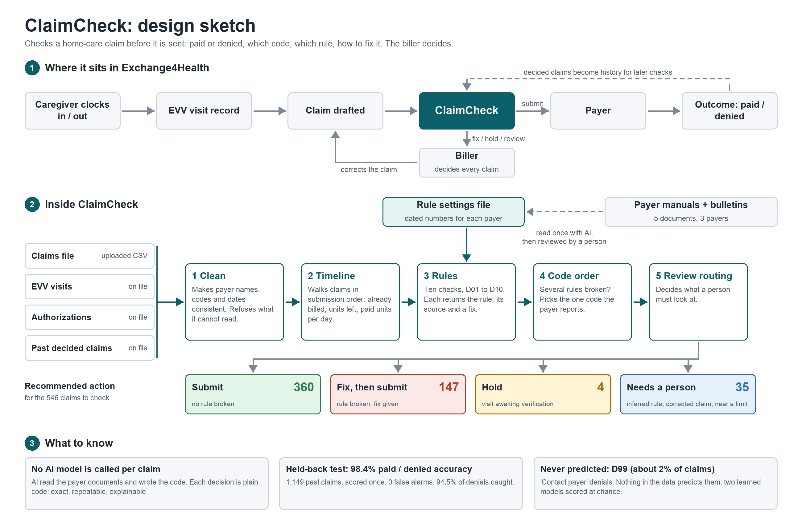

# System design: ClaimCheck

**As built:** a rules-based pre-submission checker. No AI model is called when it runs. AI (Claude) helped read the payer documents and write the rules, and a person reviewed them. Everything below describes the prototype as it stands. Things I planned but did not build are in section 8.

## 1. Problem framing
- **Who:** billing teams at home-care agencies using Exchange4Health.
- **When:** after the visit is verified and the claim is drafted, **before** it is submitted.
- **What:** for each claim, predict paid or denied and the denial code, name the rule broken with its source, suggest the fix, and say whether a person must look.
- **Good looks like:** fewer denials reach the payer (a higher first-pass rate), billers trust the reasons because each one cites the payer document, and uncertain cases go to a person instead of a guess.
- **Left out:** auto-correcting or auto-submitting claims, live platform integration, EDI formats, payer-side analytics, appeals after a denial.

## 2. Where it sits in the platform
ClaimCheck sits between "claim drafted" and "claim submitted". The biller decides every claim. ClaimCheck recommends one of four actions: submit, fix then submit, hold, or needs a person. Once the payer decides, the outcome becomes history for later checks.

Exchange4Health already holds the claims, visit (EVV) and authorization data, so no new data source is needed. In the prototype the loaders read CSV files. In production they would read the platform database. The demo screen takes an uploaded claims CSV and checks it against the stored history, visits and authorizations.

## 3. What is inside (five steps)
1. **Clean.** Payer names, codes and dates are made consistent (6 payer spellings, 2 date formats, stray spaces and case). Anything that cannot be read raises an error. Nothing is guessed or dropped quietly. 32 exact duplicate rows were removed from the history.
2. **Timeline.** Claims are walked in submission order, keeping running totals: claims already billed, units left on each authorization, and paid units per patient per day. Past claims update the totals with the payer's real decision. Claims to check update them with our own prediction.
3. **Rules.** Ten checks, one per denial code (D01 to D10). Each returns the rule broken, its source in the payer document, and a suggested fix. Every payer-specific number (filing limits, rounding, modifier dates, daily maximum) lives in `rules_config.yaml` with effective dates. A new bulletin is a settings change, not a code change.
4. **Code order.** When one claim breaks several rules, the payer reports one code. The order was set from dev claims that break two or more rules, and it differs by payer: PY03 reports authorization problems ahead of visit units.
5. **Review routing.** Decides what a person must look at.

**Key principle:** AI helped build the rules but does not make decisions. Each decision is plain code, so it is exact, repeatable, explainable and free to run.

## 4. Data used for each claim
The claim fields, the verified visit minutes for that patient, service and date, the authorization record, the timeline totals, and the payer settings in force on the date of service. The payer's `remark` column is never used as an input. It is written after the payer decides, and it exists only in the history. It was used on the dev split only to discover rules.

## 5. Human in the loop and guardrails
**Recommended actions for the 546 claims to check:**

| Action | Claims | When |
|---|---|---|
| Submit | 360 | No rule broken |
| Fix, then submit | 147 | Rule broken, fix given |
| Hold | 4 | The only visit record is awaiting verification. Wait, do not write it off |
| Needs a person | 35 | Contract rule inferred from history (D10), corrected claim, or within 2 units of an authorization or daily limit |

**Guardrails:**
- The biller decides. Nothing is changed or submitted automatically.
- Claims are cut down to an allowed list of fields before any rule sees them. A test proves no rule reads `remark`, `status` or `denial_code`.
- The raw data files are never edited, and a test compares their fingerprints on every run.
- D99 ("contact payer", "under review") is never predicted. Nothing in the data predicts it, and two learned models tried on it scored at chance. About 2% of claims will be denied for reasons no rule explains.
- Corrected claims (frequency 7) are always sent to a person, because the history has none to check against.
- Rule changes from new bulletins are reviewed by a person before they go live.

## 6. Trade-offs
| Choice | Gain | Cost |
|---|---|---|
| Rules, not a learned model | Exact, explainable, cited, free per claim | Needs upkeep when payers change rules |
| Settings file with effective dates | A bulletin is just data | The reading of the document must be reviewed |
| Never predict D99 | Honest about the limit | Caps exact-code accuracy at 98.1% |
| Running timeline | Correct authorization and daily-maximum logic | For claims to check, one wrong early prediction can carry forward. I have not measured how far |
| Code order set by hand from dev counts | Matches what payers report | Some pairs rest on few examples (for example D05 against D03) |
| D10 rule inferred from remarks | Catches all 25 dev D10 claims | Not in any payer document, so it goes to a person |
| Random split of past claims | Matches the real task, where claims to check overlap the history period | Less like predicting the future |

## 7. Evaluation (what was done)
Past claims were split 70/30 (2,681 dev, 1,149 test), stratified by payer and outcome, with a fixed seed and the split saved to a file. All rule decisions used dev only. Test was scored once at the end.

| Measure | Dev | Test |
|---|---|---|
| Paid / denied accuracy | 98.4% | 98.4% |
| Denied precision | 99.9% | 100.0% |
| Denied recall | 94.4% | 94.5% |
| False alarms | 1 | 0 |
| Exact-code accuracy | 98.1% | 98.0% |
| Best possible exact-code accuracy | 98.1% | 98.1% |

- Every missed denial is a D99.
- One review-routing change was made after the test score. It changed no status or code, and it is disclosed in `docs/findings.md`.
- One test claim contradicted the chosen code order. I left it unchanged and recorded it, to keep the score-once rule.
- Boundary cases (day 30, day 31, an 8-minute remainder, exactly 32 units) each have a unit test. The full suite is in `tests/`.
- **Caveat:** the data is synthetic and the rules fit it almost perfectly. Real payers will be messier, so treat these numbers as a prototype result, not a forecast.

## 8. What I did not build, and next steps
**Planned but not built:**
- A small learned model to choose the reported code, and optional Claude wording of the fixes. Rules alone reached the ceiling on dev, so neither was needed.
- A "simulated" evaluation that uses our own predictions for past claims, to measure how far one wrong prediction carries forward.
- A time-based split as a second robustness check, and an ablation table across tiers.

**Next steps:**
- Run the simulated evaluation. Report money at risk (billed amount flagged), not only claim counts.
- Connect to the claim-drafting screen. Read from the platform database instead of CSV files.
- Feed payer outcomes back in to watch predicted against actual denial rates by code, and flag drift for a person to review.
- Automate bulletin monitoring: an LLM proposes the settings change and a person approves it before it goes live.
- Pilot with a few agencies. Measure the change in first-pass rate and days to cash, and name one person who owns the rules.
