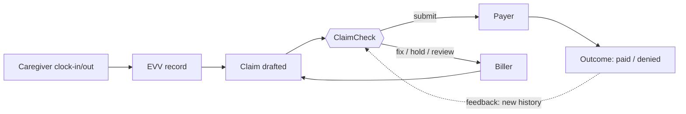
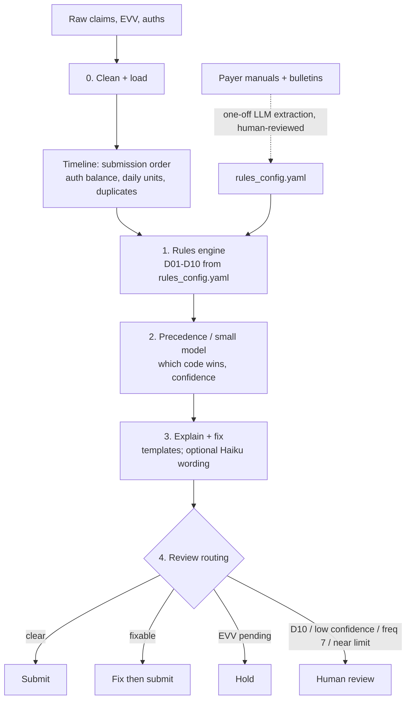

# System design: ClaimCheck

## 1. Problem framing
- **Who:** billing teams at home-care agencies using Exchange4Health.
- **When:** after the visit is verified and the claim is drafted, **before** it is submitted.
- **What:** predict paid/denied + denial code, explain the rule, suggest the fix, and flag what a human must decide.
- **Good looks like:** fewer denials reach the payer (a higher first-pass rate), billers trust the reasons (each one has a citation), and uncertain cases go to a person, not a guess.
- **Left out:** auto-correction or auto-submission, real-time platform integration, EDI formats, payer-side analytics, post-denial appeals.

## 2. Where it sits in the platform

Exchange4Health already holds the claims, EVV and authorization data, so ClaimCheck needs no new data source. In the prototype, the loaders read CSVs; in production they would read the platform database.

## 3. Components (cascade)

| Tier | What it does | Type | Token cost |
|---|---|---|---|
| 0 Clean | Payer aliases, codes, mixed dates, duplicate rows | Code | 0 |
| 1 Rules | EVV, units, auth, filing, modifier, duplicate, daily max, contract | Code + config | 0 |
| 2 Precedence/model | Picks the one reported code; confidence | Learned on dev | 0 |
| 3 Explain | Plain-English reason + fix | Templates; optional Haiku | ~0 (only flagged claims if on) |
| 4 Review | Who decides | Rules | 0 |

**Key principle:** the LLM is a *compiler, not a runtime*. It turns payer documents into reviewed config once. Every per-claim decision is code, so decisions are exact, auditable and free.

## 4. Data and context per claim
Claim fields; the verified EVV minutes for (patient, service, date of service); the authorization record; the timeline state (auth units remaining, the patient's paid units that day, earlier claims with the same key); the payer config for that date of service.

## 5. Human in the loop and guardrails
- The biller makes every final decision; ClaimCheck recommends `submit`, `fix_then_submit`, `hold` or `review`.
- Routed to review: D10 (contract rules partly inferred), low confidence, corrected claims (no history examples), claims near an auth or daily limit.
- "Hold" for pending EVV: the right action is to wait, not to write off.
- The LLM can't change a decision; its output is validated, with the template as fallback.
- Rule changes from new bulletins go through human review of the config before going live.

## 6. Trade-offs
| Choice | Gain | Cost |
|---|---|---|
| Rules over an ML classifier | Exact, explainable, cited, cheap | Needs upkeep when payers change rules |
| Config with effective dates | Bulletins are just data | The extraction must be reviewed |
| Never predict D99 | Honest | Caps accuracy (~61 unpredictable history denials) |
| Sequential timeline | Correct auth/daily-max logic | One wrong prediction can carry through to later claims (measured in simulated mode) |
| Stratified random split | Matches the overlapping to-check period | Less like "predicting the future" (time split reported as a check) |

## 7. Evaluation
A 70/30 stratified dev/test split of the de-duplicated history. Tune on dev only; score test once. Metrics: paid/denied accuracy, denied precision/recall, exact-code accuracy, per-code results, review rate, D99 ceiling. Ablation: rules → + precedence → + model → + LLM (tokens). Robustness: time split and simulated mode.

## 8. Next steps (beyond the prototype)
Integrate into the claim-drafting screen; a feedback loop from payer outcomes to re-learn precedence and catch rule drift; automated bulletin monitoring with LLM extraction + human approval; an agency-level contract-rule library; pilot with a few agencies, measuring the change in first-pass rate and days to cash.
